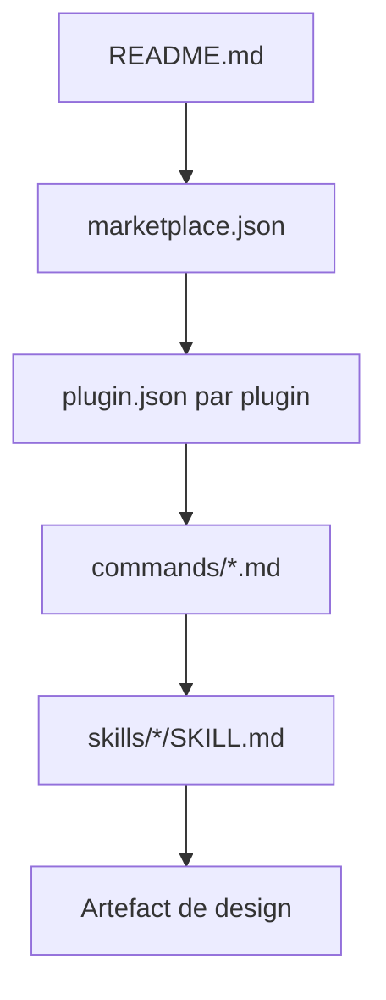

# Owl-Listener/designer-skills

> Marketplace of Claude Code and Gemini CLI skills and commands for designers, from research to interface.

## The problem
An agent reads text literally: without design knowledge written for it, it fills the gaps with guesses.

## What it actually does
A marketplace of Markdown plugins: 111 skills and 34 commands across nine plugins (research, systems, UX strategy, UI, interaction, testing, ops, toolkit, critique), plus four collections in other repositories. The commands (`/design-research:discover`) chain the skills to produce a plan, an audit or a specification.

## How it is wired


## Trying it
```bash
/plugin marketplace add Owl-Listener/designer-skills
/plugin install ux-strategy@designer-skills
```

## Cost and gotchas
Free, MIT. You need Claude Code or Gemini CLI. Installing many plugins is not discouraged by the README, which calls them lightweight. The skill counts vary between README sections (273, 111, 107).

## What it is not
No executable code: only prompt content. Not a mockup tool: outputs are text. No quality validation is described.

## Alternatives
No alternative named in the README.

## For you
Ignore: these skills target product designers, not a data / AI / MLOps profile.
