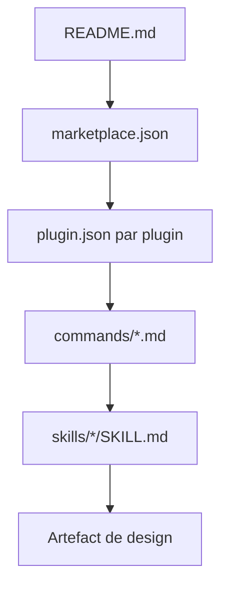

# Owl-Listener/designer-skills

> Marketplace de skills et commandes Claude Code et Gemini CLI pour les designers, de la recherche à l'interface.

## Le problème
Un agent lit le texte à la lettre : sans connaissance de design écrite pour lui, il comble les trous par des suppositions.

## Ce que ça fait vraiment
Un marketplace de plugins en Markdown : 111 skills et 34 commandes dans neuf plugins (research, systems, UX strategy, UI, interaction, testing, ops, toolkit, critique), plus quatre collections dans d'autres dépôts. Les commandes (`/design-research:discover`) enchaînent les skills pour produire un plan, un audit ou une spécification.

## Comment c'est branché


## Essayer
```bash
/plugin marketplace add Owl-Listener/designer-skills
/plugin install ux-strategy@designer-skills
```

## Coût et pièges
Gratuit, MIT. Il faut Claude Code ou Gemini CLI. Installer beaucoup de plugins n'est pas déconseillé par le README, qui les dit légers. Les chiffres de skills varient entre sections du README (273, 111, 107).

## Ce que ce n'est pas
Pas de code exécutable : seulement du contenu de prompt. Pas d'outil de maquettage : les sorties sont du texte. Aucune validation de qualité n'est décrite.

## Alternatives
Aucune alternative nommée dans le README.

## Pour toi
À ignorer : ces skills visent les designers produit, pas un profil data / IA / MLOps.

