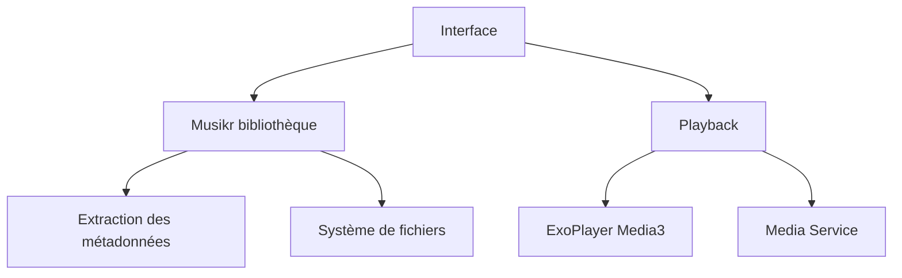

# OxygenCobalt/Auxio

> Simple, offline local music player for Android, for those who own their audio files.

## The problem
Legacy Android players are slow, cluttered with useless features and handle advanced tags poorly.

## What it actually does
Player based on Media3 ExoPlayer, with gapless playback, ReplayGain, playlists, handling of multiple artists, SD card folders, widgets and Android Auto. It works offline. The `musikr` module extracts metadata with taglib in native code.

## How it is wired


## Trying it
```bash
git clone --recurse-submodules <url du dépôt>
./gradlew assembleDebug
./gradlew installDebug
```

## Cost and gotchas
Free. Building is impossible on Windows (Unix scripts); you need cmake, ninja-build, NDK 28.2.13676358 and Java 21. The default branch is the development version.

## What it is not
Not a streaming service: it only plays local files. The README describes no app download, only building.

## Alternatives
No alternative named in the README.

## For you
Ignore: well-designed Android player but unrelated to a data / AI / MLOps profile.
