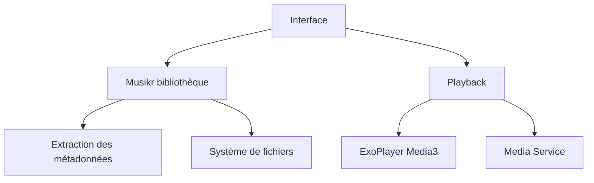

# OxygenCobalt/Auxio

> Lecteur de musique local pour Android, simple et hors ligne, pour qui possède ses fichiers audio.

## Le problème
Les lecteurs Android hérités sont lents, encombrés de fonctions inutiles et gèrent mal les tags avancés.

## Ce que ça fait vraiment
Lecteur basé sur Media3 ExoPlayer, avec lecture sans coupure, ReplayGain, playlists, gestion des artistes multiples, des dossiers de carte SD, widgets et Android Auto. Il fonctionne hors ligne. Le module `musikr` extrait les métadonnées avec taglib en code natif.

## Comment c'est branché


## Essayer
```bash
git clone --recurse-submodules <url du dépôt>
./gradlew assembleDebug
./gradlew installDebug
```

## Coût et pièges
Gratuit. Compilation impossible sous Windows (scripts Unix) ; il faut cmake, ninja-build, le NDK 28.2.13676358 et Java 21. La branche par défaut est la version de développement.

## Ce que ce n'est pas
Ce n'est pas un service de streaming : il lit uniquement les fichiers locaux. Le README ne décrit pas de téléchargement d'application, seulement la compilation.

## Alternatives
Aucune alternative nommée dans le README.

## Pour toi
Ignorer : lecteur Android bien conçu mais sans rapport avec un profil data / IA / MLOps.

