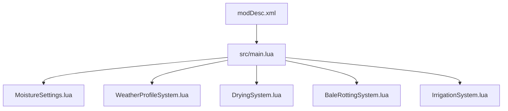

# Ozz-Modding/FS25_MoistureSystem

> Moisture simulation mod for Farming Simulator 25, for players.

## The problem
In the base game, the moisture of crops and bales affects neither the harvest nor prices.

## What it actually does
Adds dynamic field moisture (terrain, weather, temperature, time of day), a quality grade from A to D that modulates the selling price, grass drying by tedding, rotting of bales and piles, a hygrometer and a menu of ranges per crop. Multiplayer compatible, seven regional weather profiles, which users can create.

## How it is wired


## Trying it
```bash
# aucune commande : placer le mod dans le dossier mods de Farming Simulator 25
```

## Cost and gotchas
Free, but you must own the game. No license declared.

## What it is not
Not a real agronomic simulation tool: it is a video game mod.

## Alternatives
No alternative named in the README.

## For you
Ignore: a game mod unrelated to your field.
