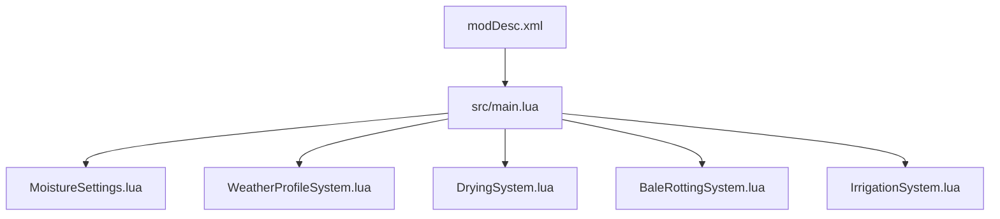

# Ozz-Modding/FS25_MoistureSystem

> Mod de simulation d'humidité pour Farming Simulator 25, pour joueurs.

## Le problème
Dans le jeu de base, l'humidité des cultures et des balles n'influence pas la récolte ni les prix.

## Ce que ça fait vraiment
Ajoute une humidité dynamique des champs (relief, météo, température, heure), une note de qualité de A à D qui module le prix de vente, le séchage de l'herbe par fanage, la pourriture des balles et des tas, un hygromètre et un menu des plages par culture. Compatible multijoueur, sept profils météo régionaux, créables par l'utilisateur.

## Comment c'est branché


## Essayer
```bash
# aucune commande : placer le mod dans le dossier mods de Farming Simulator 25
```

## Coût et pièges
Gratuit, mais il faut posséder le jeu. Aucune licence déclarée.

## Ce que ce n'est pas
Pas un outil de simulation agronomique réelle : c'est un mod de jeu vidéo.

## Alternatives
Aucune alternative nommée dans le README.

## Pour toi
Ignorer : un mod de jeu sans rapport avec ton métier.

