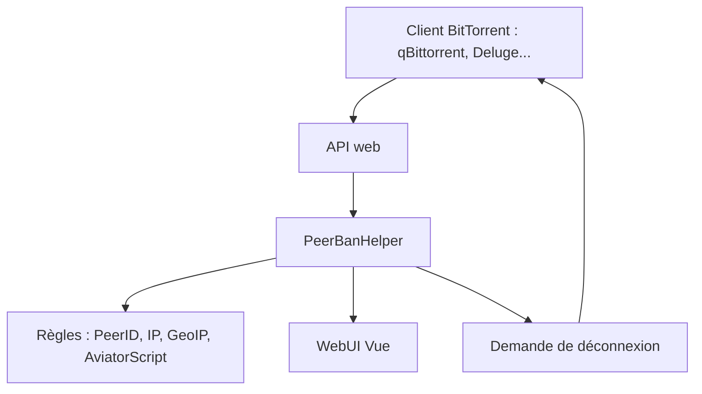

# PeerBanHelper

> Personal firewall that automatically bans abusive or abnormal BitTorrent clients, for torrent users.

## The problem
BitTorrent peers drain bandwidth without sharing, or forge their identity.

## What it actually does
Connects to a BitTorrent client's web API, reads peer connections and asks the client to disconnect those matching the rules: PeerID and client name blacklists, IP and GeoIP, fake progress, chain banning. A Vue web interface shows the banned peers and statistics.

## How it is wired
Simplified diagram based on the fiche, no diagram provided.

## Trying it
No command documented in the README: see the online documentation.

## Cost and gotchas
Free. You need a supported client (qBittorrent 4.5.0 or later, Transmission 4.1.0-beta2 or later, etc.). In Docker, the client must use the `host` network. A GeoIP database is downloaded at startup. The service is in Java: real prerequisite not listed.

## What it is not
Not a general network firewall: it only acts through the torrent client's API. It ignores I2P and Tor.

## Alternatives
No alternative named in the README.

## For you
Ignore: torrent management utility, unrelated to data, AI or MLOps work.
