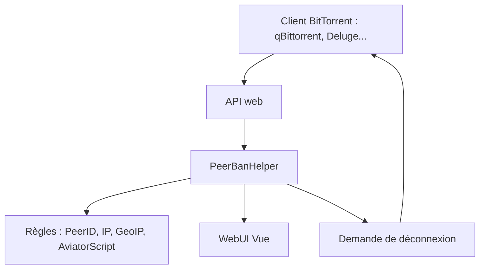

# PeerBanHelper

> Pare-feu personnel qui bannit automatiquement les clients BitTorrent abusifs ou anormaux, pour utilisateurs de torrents.

## Le problème
Des pairs BitTorrent sucent la bande passante sans partager, ou falsifient leur identité.

## Ce que ça fait vraiment
Se connecte à l'API web d'un client BitTorrent, lit les connexions de pairs et demande au client de déconnecter ceux qui correspondent aux règles : listes noires PeerID et nom de client, IP et GeoIP, faux progrès, bannissement en chaîne. Une interface web Vue montre les bannis et les statistiques.

## Comment c'est branché
Schéma simplifié d'après la fiche, sans diagramme fourni.

## Essayer
Aucune commande documentée dans le README : voir la documentation en ligne.

## Coût et pièges
Gratuit. Il faut un client pris en charge (qBittorrent 4.5.0 ou plus, Transmission 4.1.0-beta2 ou plus, etc.). En Docker, le client doit utiliser le réseau `host`. Une base GeoIP est téléchargée au démarrage. Le service est en Java : prérequis réel non listé.

## Ce que ce n'est pas
Ce n'est pas un pare-feu réseau général : il n'agit que via l'API du client torrent. Il ignore I2P et Tor.

## Alternatives
Aucune alternative nommée dans le README.

## Pour toi
À ignorer : utilitaire de gestion de torrents, sans lien avec le travail data, IA ou MLOps.

