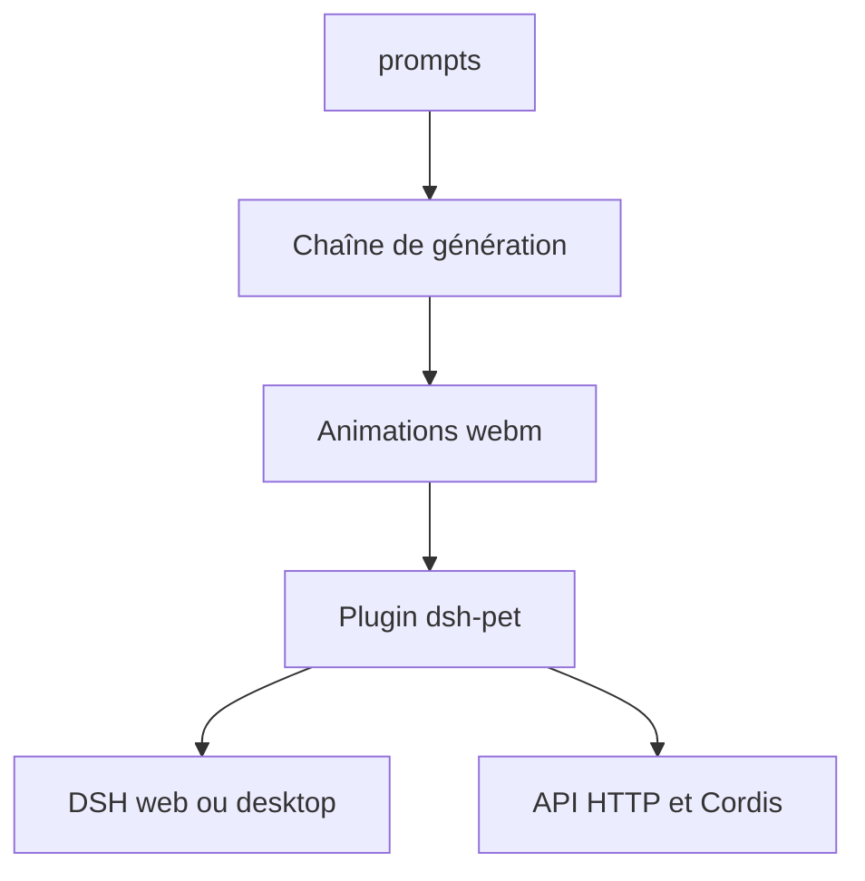

# PC2005-cloud/dsh-pet

> Animated desktop mascot plugin for DeepSeek Harness, with an animation generation pipeline.

## The problem
No visual companion reacting to sessions and account balance in DeepSeek Harness (DSH).

## What it actually does
Over a hundred transparent animations (webm VP9 alpha), physical interactions, conversation with memory and voice, per-service balance display, work states tied to DSH sessions, task list, system notifications. Three modes: browser overlay, transparent Electron window, standalone mode. Two APIs for other plugins: local HTTP and Cordis service.

## How it is wired
Simplified diagram based on the sheet, no diagram provided.



## Trying it
```bash
dsh plugin --profile <profil> add dsh-pet
```
The profile is `web` or `desktop` depending on the interface used.

## Cost and gotchas
Free. Restart DSH after installation. The HTTP API has no authentication (local only). Safari not supported.

## What it is not
Code under MIT, but animations and prompts are reserved for non-commercial use; the image is a fan creation under CC BY-NC-SA 4.0, unofficial.

## Alternatives
No alternative named in the README.

## For you
Ignore: visual gadget for DeepSeek Harness, of no value for data, AI or MLOps work.
