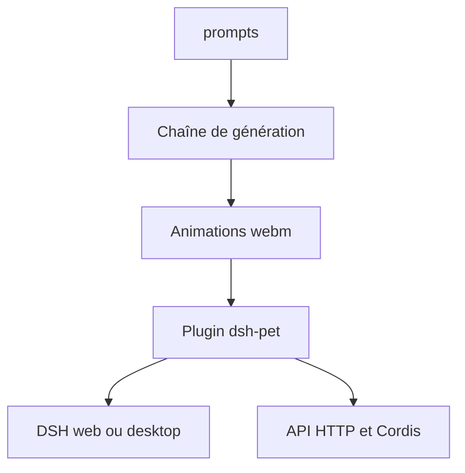

# PC2005-cloud/dsh-pet

> Plugin de mascotte de bureau animée pour DeepSeek Harness, avec chaîne de génération des animations.

## Le problème
Pas de compagnon visuel réagissant aux sessions et au solde du compte dans DeepSeek Harness (DSH).

## Ce que ça fait vraiment
Plus de cent animations transparentes (webm VP9 alpha), interactions physiques, conversation avec mémoire et voix, affichage du solde par service, états de travail liés aux sessions DSH, liste de tâches, notifications système. Trois modes : overlay navigateur, fenêtre Electron transparente, mode autonome. Deux API pour d'autres plugins : HTTP local et service Cordis.

## Comment c'est branché
Schéma simplifié d'après la fiche, sans diagramme fourni.



## Essayer
```bash
dsh plugin --profile <profil> add dsh-pet
```
Le profil est `web` ou `desktop` selon l'interface utilisée.

## Coût et pièges
Gratuit. Redémarrer DSH après installation. L'API HTTP n'a pas d'authentification (locale uniquement). Safari non supporté.

## Ce que ce n'est pas
Code sous MIT, mais animations et prompts réservés à l'usage non commercial ; l'image est une création de fans sous CC BY-NC-SA 4.0, non officielle.

## Alternatives
Aucune alternative nommée dans le README.

## Pour toi
À ignorer : gadget visuel pour DeepSeek Harness, sans valeur pour un travail data, IA ou MLOps.

