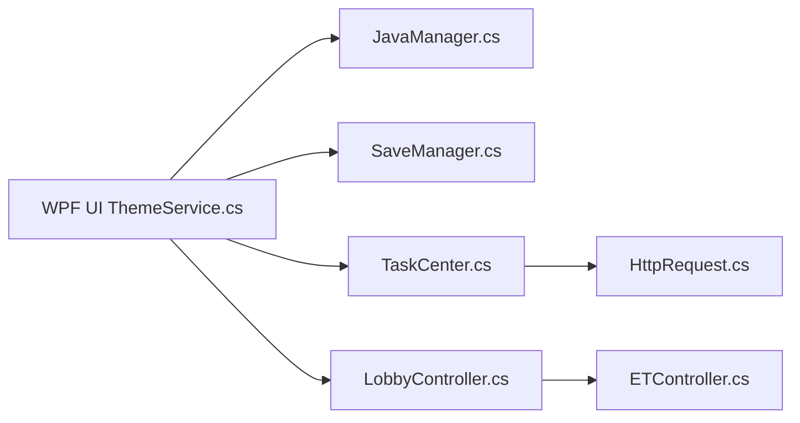

# PCL-Community/PCL-CE

> Community Minecraft launcher for Windows, the community edition of Plain Craft Launcher 2.

## The problem
Managing Java, profiles, mods and Minecraft saves in a single launcher.

## What it actually does
The README (in Chinese) only describes platforms: Windows 10 1809+ with .NET 10 supported, Windows 8 at best, Windows 7 not supported. From the code: Java discovery, profiles/authentication, mod resources, saves, cache, downloads, multiplayer lobby via EasyTier, updates. Mixed license: the `Plain Craft Launcher 2/` folder under a custom license, the rest Apache-2.0.

## How it is wired

## Trying it
No command documented in the README.

## Cost and gotchas
Free. Short README (insufficient material), partly custom license to read before reuse.

## What it is not
Not a cross-platform tool: Linux/macOS are only used for building.

## Alternatives
No alternative named in the README.

## For you
Ignore: a Windows game launcher, out of scope.
