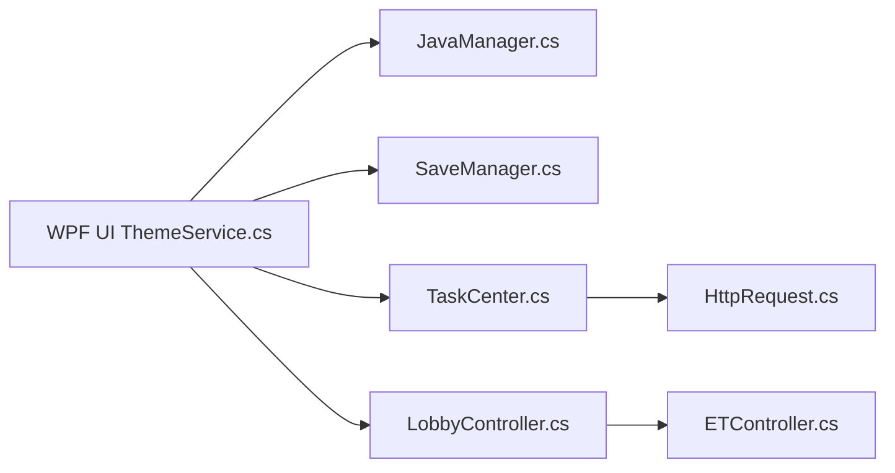

# PCL-Community/PCL-CE

> Lanceur Minecraft communautaire pour Windows, édition communautaire de Plain Craft Launcher 2.

## Le problème
Gérer Java, profils, mods et sauvegardes Minecraft dans un seul lanceur.

## Ce que ça fait vraiment
Le README (en chinois) ne décrit que les plateformes : Windows 10 1809+ avec .NET 10 pris en charge, Windows 8 au mieux, Windows 7 non. D'après le code : découverte de Java, profils/authentification, ressources de mods, sauvegardes, cache, téléchargements, lobby multijoueur via EasyTier, mises à jour. Licence mixte : dossier `Plain Craft Launcher 2/` sous licence personnalisée, le reste Apache-2.0.

## Comment c'est branché

## Essayer
Aucune commande documentée dans le README.

## Coût et pièges
Gratuit. README court (matière insuffisante), licence partiellement personnalisée à lire avant réutilisation.

## Ce que ce n'est pas
Pas un outil multiplateforme : Linux/macOS ne servent qu'à compiler.

## Alternatives
Aucune alternative nommée dans le README.

## Pour toi
À ignorer : lanceur de jeu Windows, hors périmètre.

