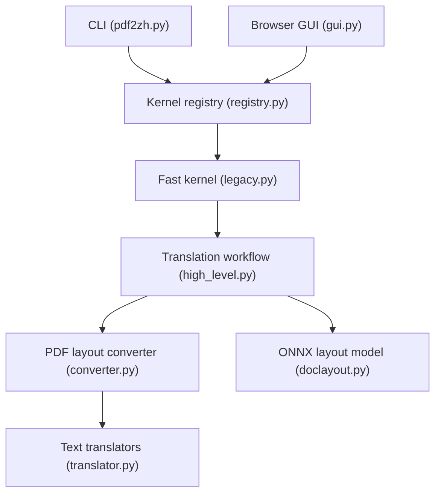

# PDFMathTranslate/PDFMathTranslate

> Translates scientific PDFs while preserving formulas, figures and layout, via command line, web interface or Docker.

## The problem
Translating a scientific paper with a generic translator breaks formulas, tables and layout.

## What it actually does
`pdf2zh` produces a translated PDF (`-mono`) and a bilingual PDF (`-dual`). Layout detection with the ONNX model DocLayout-YOLO, choice of translation service (Google by default, DeepL, OpenAI...). Experimental modes: OCR for scanned pages, `--ultrafast` for native-text PDFs. MCP server, Python and HTTP APIs available.

## How it is wired


## Trying it
```bash
pip install uv
uv tool install --python 3.12 pdf2zh
pdf2zh document.pdf
pdf2zh -i
docker pull byaidu/pdf2zh
docker run -d -p 7860:7860 byaidu/pdf2zh
```

## Cost and gotchas
Python 3.11 to 3.12 required. The layout model is downloaded from Hugging Face (mirror to configure in some regions). Paid services require your key. Online demos have limited resources.

## What it is not
Not a general-purpose OCR: OCR is experimental, limited to scans on a white background. The README notes that version 2.0 lives in the PDFMathTranslate-next repository. AGPL license.

## Alternatives
- PDFMathTranslate/PDFMathTranslate-next: fork with a web interface and more edge cases handled, but intended for development.
- BabelDOC: new backend cited in the README.

## For you
Very useful for reading foreign-language papers while keeping the equations; adopt, with an API key depending on the chosen service.
