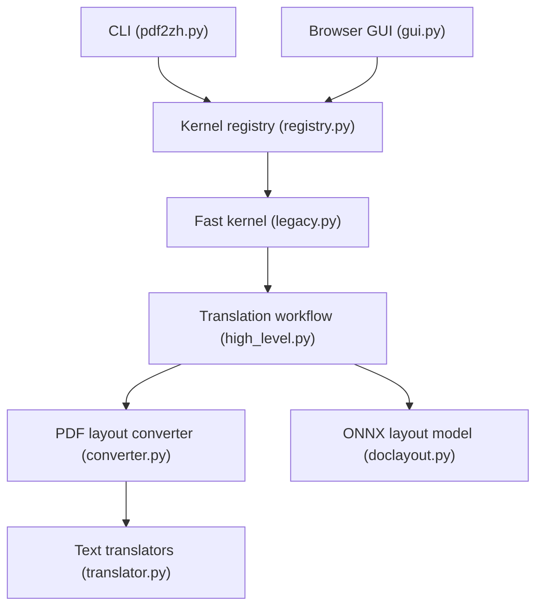

# PDFMathTranslate/PDFMathTranslate

> Traduit des PDF scientifiques en conservant formules, figures et mise en page, en ligne de commande, interface web ou Docker.

## Le problème
Traduire un article scientifique par un traducteur générique casse formules, tableaux et mise en page.

## Ce que ça fait vraiment
`pdf2zh` produit un PDF traduit (`-mono`) et un PDF bilingue (`-dual`). Détection de mise en page par modèle ONNX DocLayout-YOLO, choix du service de traduction (Google par défaut, DeepL, OpenAI...). Modes expérimentaux : OCR pour pages scannées, `--ultrafast` pour PDF à texte natif. Serveur MCP, API Python et HTTP disponibles.

## Comment c'est branché


## Essayer
```bash
pip install uv
uv tool install --python 3.12 pdf2zh
pdf2zh document.pdf
pdf2zh -i
docker pull byaidu/pdf2zh
docker run -d -p 7860:7860 byaidu/pdf2zh
```

## Coût et pièges
Python 3.11 à 3.12 exigé. Le modèle de mise en page se télécharge depuis Hugging Face (miroir à configurer dans certaines régions). Les services payants demandent ta clé. Les démos en ligne ont des ressources limitées.

## Ce que ce n'est pas
Pas un OCR général : l'OCR est expérimental, limité aux scans sur fond blanc. Le README signale que la version 2.0 vit dans le dépôt PDFMathTranslate-next. Licence AGPL.

## Alternatives
- PDFMathTranslate/PDFMathTranslate-next : fork avec interface web et plus de cas limites traités, mais destiné au développement.
- BabelDOC : nouveau backend cité au README.

## Pour toi
Très utile pour lire des papiers en langue étrangère en gardant les équations ; à adopter, avec une clé d'API selon le service choisi.

