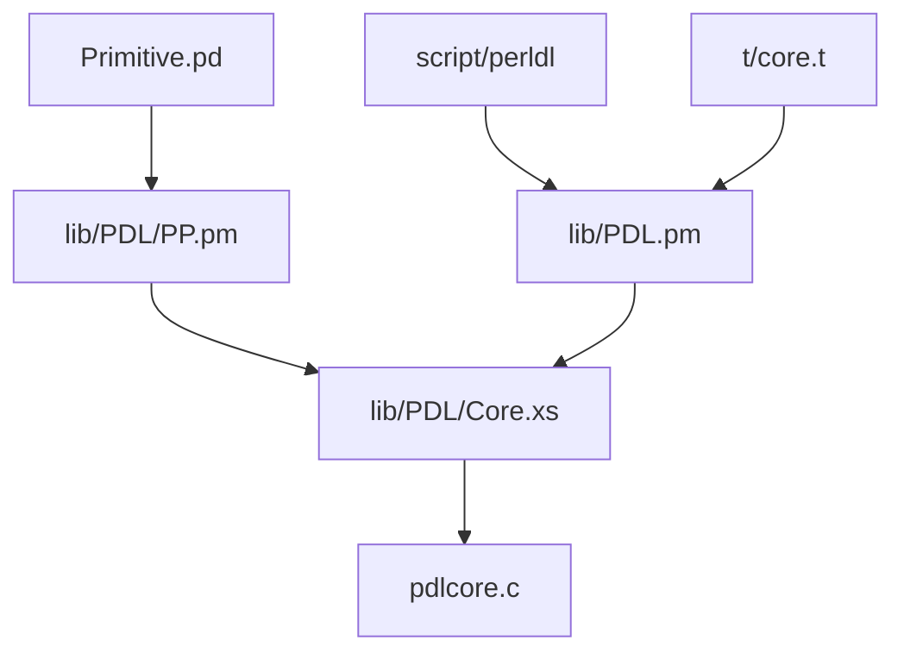

# PDLPorters/pdl

> Perl Data Language: N-dimensional numeric arrays in Perl, for scientific computing.

## The problem
Standard Perl handles large numeric arrays poorly.

## What it actually does
Stores N-dimensional arrays compactly and manipulates them as a whole, with an interactive `perldl` shell. According to the architecture, `.pd` files go through the PP generator, which produces XS and C code built on the `pdlcore` kernel. `PDL.pm` and `perldl` expose the kernel, checked by the tests in the `t` folder.

## How it is wired


## Trying it
```bash
perl -Mblib blib/script/perldl
pdl   # après make install
```

## Cost and gotchas
Free. Compilation with a C compiler and Perl; license not identified by GitHub. The README says no warranty is provided.

## What it is not
Not an equivalent of NumPy in the Python ecosystem: PDL serves only Perl. The comparison with MatLab and IDL is the authors' opinion.

## Alternatives
No alternative named in the README (IDL and MatLab are cited as commercial references).

## For you
Ignore: you work in Python, where NumPy already covers this need.
