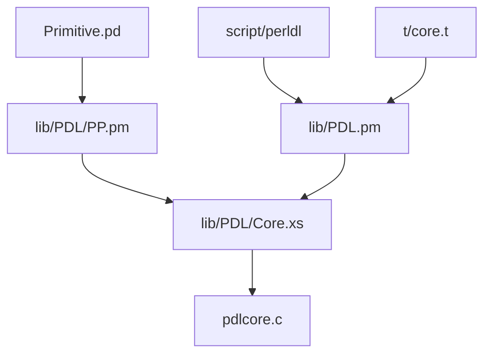

# PDLPorters/pdl

> Perl Data Language : tableaux numériques à N dimensions en Perl, pour le calcul scientifique.

## Le problème
Perl standard manipule mal de grands tableaux numériques.

## Ce que ça fait vraiment
Stocke de façon compacte des tableaux à N dimensions et les manipule globalement, avec un shell interactif `perldl`. D'après l'architecture, des fichiers `.pd` passent par le générateur PP, qui produit du code XS et C appuyé sur le noyau `pdlcore`. `PDL.pm` et `perldl` exposent le noyau, vérifié par les tests du dossier `t`.

## Comment c'est branché


## Essayer
```bash
perl -Mblib blib/script/perldl
pdl   # après make install
```

## Coût et pièges
Gratuit. Compilation avec un compilateur C et Perl ; licence non identifiée par GitHub. Le README dit qu'aucune garantie n'est fournie.

## Ce que ce n'est pas
Pas un équivalent de NumPy dans l'écosystème Python : PDL ne sert qu'à Perl. La comparaison avec MatLab et IDL est l'avis des auteurs.

## Alternatives
Aucune alternative nommée dans le README (IDL et MatLab sont cités comme références commerciales).

## Pour toi
Ignorer : tu travailles en Python, où NumPy couvre déjà ce besoin.

