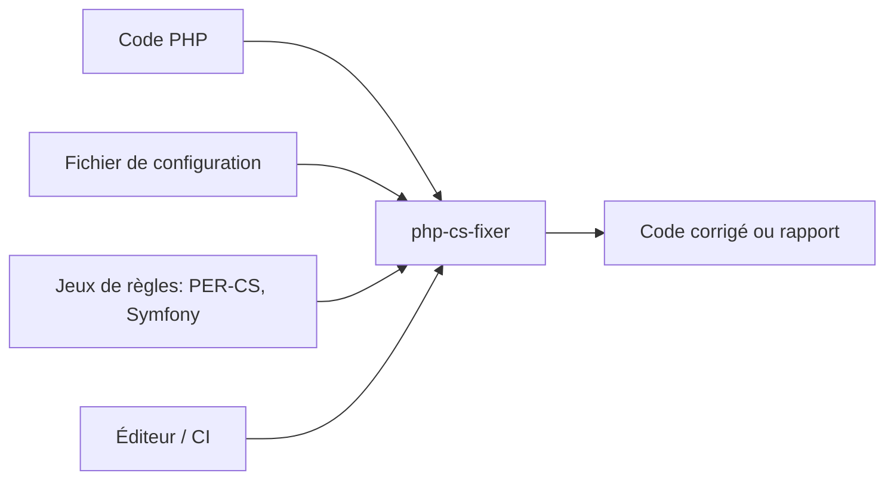

# PHP-CS-Fixer/PHP-CS-Fixer

> A tool that automatically fixes PHP code style according to standards, for PHP teams.

## The problem
Fixing code style deviations by hand is slow on a large project, and a plain linter only detects them.

## What it actually does
Detects and fixes PHP style deviations. Built-in rule sets: PER-CS, Symfony, PhpCsFixer, plus migration sets (`@autoPHPMigration`, `@autoPHPUnitMigration:risky`) and `@auto`. You can define your rules in a configuration file or create custom rules. It integrates with PhpStorm (natively) and with community plugins for NetBeans, Sublime Text, Vim, VS Code.

## How it is wired


## Trying it
```bash
composer require --dev friendsofphp/php-cs-fixer
./vendor/bin/php-cs-fixer init
./vendor/bin/php-cs-fixer fix
./vendor/bin/php-cs-fixer check
```

## Cost and gotchas
Free, MIT. The "risky" rules (`@auto:risky`) can change the behavior of the code. In case of dependency conflicts, the README suggests the `php-cs-fixer/shim` package.

## What it is not
Not a bug or security analyzer: it only handles style and syntax modernization.

## Alternatives
None named in the README, apart from an unidentified "linter".

## For you
Ignore: reserved for PHP projects, with no use in data/AI/MLOps work in Python.
