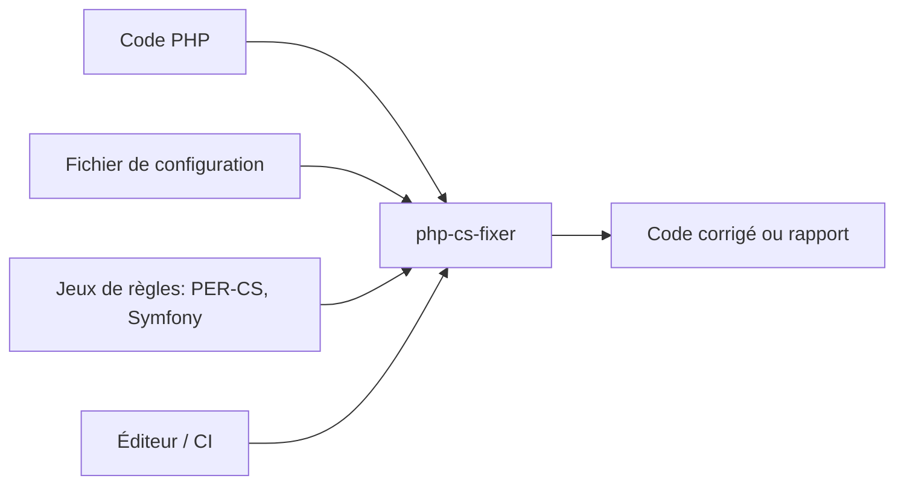

# PHP-CS-Fixer/PHP-CS-Fixer

> Outil qui corrige automatiquement le style du code PHP selon des standards, pour équipes PHP.

## Le problème
Corriger à la main les écarts de style de code est long sur un gros projet, un simple linter ne fait que les détecter.

## Ce que ça fait vraiment
Détecte et corrige les écarts de style PHP. Jeux de règles intégrés : PER-CS, Symfony, PhpCsFixer, plus des jeux de migration (`@autoPHPMigration`, `@autoPHPUnitMigration:risky`) et `@auto`. On peut définir ses règles dans un fichier de configuration ou créer des règles personnalisées. Il s'intègre à PhpStorm (natif) et à des greffons communautaires pour NetBeans, Sublime Text, Vim, VS Code.

## Comment c'est branché


## Essayer
```bash
composer require --dev friendsofphp/php-cs-fixer
./vendor/bin/php-cs-fixer init
./vendor/bin/php-cs-fixer fix
./vendor/bin/php-cs-fixer check
```

## Coût et pièges
Gratuit, MIT. Les règles « risky » (`@auto:risky`) peuvent changer le comportement du code. En cas de conflit de dépendances, le README propose le paquet `php-cs-fixer/shim`.

## Ce que ce n'est pas
Pas un analyseur de bugs ni de sécurité : il ne traite que le style et la modernisation de syntaxe.

## Alternatives
Aucune nommée dans le README, hors un « linter » non identifié.

## Pour toi
Ignorer : réservé aux projets PHP, sans usage dans un travail data/IA/MLOps en Python.

