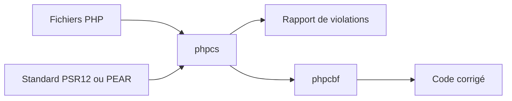

# PHPCSStandards/PHP_CodeSniffer

> PHP tool that detects and fixes deviations from a coding standard, for PHP developers.

## The problem
PHP teams write code in uneven styles, and manually reviewing conventions is slow.

## What it actually does
Two scripts: `phpcs` analyzes PHP files and reports violations of the standard (PSR12 by default, PEAR optionally); `phpcbf` automatically fixes what can be fixed. Distributed as a signed Phar, via Composer or Phive. It is the official continuation of the abandoned Squizlabs package.

## How it is wired

Simplified diagram based on the sheet, no diagram provided.

## Trying it
```bash
curl -OL https://phars.phpcodesniffer.com/phpcs.phar
php phpcs.phar -h
composer global require "squizlabs/php_codesniffer=*"
phpcs /path/to/code-directory
phpcs --standard=PEAR /path/to/code-directory
```

## Cost and gotchas
Free. Requires PHP 7.2.0 or later; some rules need external tools. Messages and fixes may vary from one patch version to another.

## What it is not
Not a bug or security analyzer: it checks code style. Nothing to do with Python: it only applies to PHP code.

## Alternatives
No alternative named in the README.

## For you
Ignore: reserved for PHP projects, no use in Python data / AI / MLOps work.
