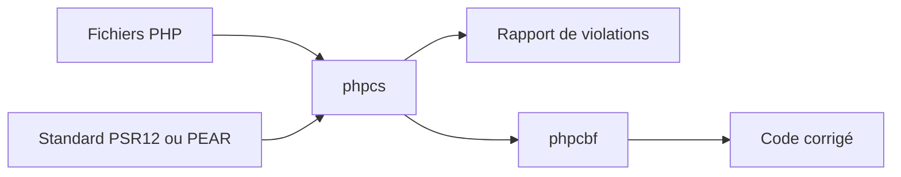

# PHPCSStandards/PHP_CodeSniffer

> Outil PHP qui détecte et corrige les écarts à un standard de code, pour développeurs PHP.

## Le problème
Les équipes PHP écrivent du code au style hétérogène, et la revue manuelle des conventions est lente.

## Ce que ça fait vraiment
Deux scripts : `phpcs` analyse les fichiers PHP et signale les violations du standard (PSR12 par défaut, PEAR au choix) ; `phpcbf` corrige automatiquement ce qui peut l'être. Distribué en Phar signé, via Composer ou Phive. C'est la continuation officielle du paquet Squizlabs abandonné.

## Comment c'est branché

Schéma simplifié d'après la fiche, sans diagramme fourni.

## Essayer
```bash
curl -OL https://phars.phpcodesniffer.com/phpcs.phar
php phpcs.phar -h
composer global require "squizlabs/php_codesniffer=*"
phpcs /path/to/code-directory
phpcs --standard=PEAR /path/to/code-directory
```

## Coût et pièges
Gratuit. Demande PHP 7.2.0 ou plus ; certaines règles exigent des outils externes. Les messages et corrections peuvent varier d'une version de correctif à l'autre.

## Ce que ce n'est pas
Pas un analyseur de bugs ni de sécurité : il contrôle le style de code. Rien à voir avec Python : il ne s'applique qu'au code PHP.

## Alternatives
Aucune alternative nommée dans le README.

## Pour toi
À ignorer : réservé aux projets PHP, sans usage dans un travail data / IA / MLOps en Python.

