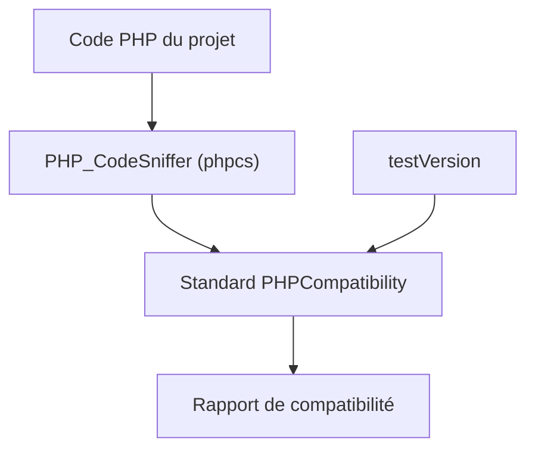

# PHPCompatibility/PHPCompatibility

> PHP_CodeSniffer ruleset that checks PHP code compatibility across versions.

## The problem
Changing PHP version silently breaks code: removed functions, new syntax.

## What it actually does
PHP_CodeSniffer sniffs detect deprecated, removed or new features according to a target version (testVersion), for example 7.0- or 5.3-5.5. Results are identical whatever PHP version runs the analysis. Dedicated rulesets exist for WordPress, Joomla and Symfony or Paragonie polyfills. Installation is through Composer only.

## How it is wired
Simplified diagram based on the fiche, no diagram provided.



## Trying it
```bash
composer config allow-plugins.dealerdirect/phpcodesniffer-composer-installer true
composer require --dev phpcompatibility/php-compatibility:"^10.0.0@dev"
vendor/bin/phpcs -ps . --standard=PHPCompatibility
vendor/bin/phpcs -p . --standard=PHPCompatibility --runtime-set testVersion 7.0-
```

## Cost and gotchas
Free (LGPL-3.0). PHP 7.2 or later, PHP_CodeSniffer 4.0.2 or later and PHPCSUtils are required. The project asks for funding. Without testVersion, only deprecated or removed features are reported.

## What it is not
It is not a security analyzer or a test runner. It is not a tool outside the PHP world.

## Alternatives
No alternative named in the README.

## For you
Ignore: useful only for migrating PHP code, outside the data, AI and MLOps scope.
