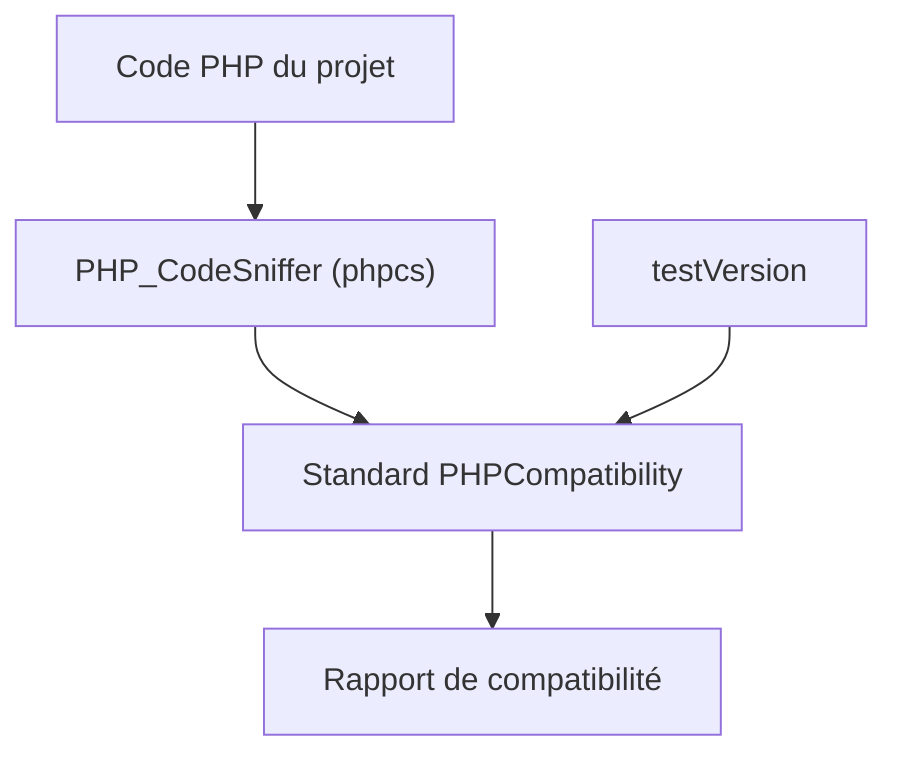

# PHPCompatibility/PHPCompatibility

> Ensemble de règles PHP_CodeSniffer qui vérifie la compatibilité d'un code PHP entre versions.

## Le problème
Changer de version de PHP casse du code de façon silencieuse : fonctions retirées, syntaxe nouvelle.

## Ce que ça fait vraiment
Des sniffs PHP_CodeSniffer repèrent les fonctionnalités dépréciées, retirées ou nouvelles selon une version cible (testVersion), par exemple 7.0- ou 5.3-5.5. Les résultats sont identiques quelle que soit la version de PHP qui exécute l'analyse. Des jeux de règles dédiés existent pour WordPress, Joomla et des polyfills Symfony ou Paragonie. L'installation passe par Composer seulement.

## Comment c'est branché
Schéma simplifié d'après la fiche, sans diagramme fourni.



## Essayer
```bash
composer config allow-plugins.dealerdirect/phpcodesniffer-composer-installer true
composer require --dev phpcompatibility/php-compatibility:"^10.0.0@dev"
vendor/bin/phpcs -ps . --standard=PHPCompatibility
vendor/bin/phpcs -p . --standard=PHPCompatibility --runtime-set testVersion 7.0-
```

## Coût et pièges
Gratuit (LGPL-3.0). Il faut PHP 7.2 ou plus, PHP_CodeSniffer 4.0.2 ou plus et PHPCSUtils. Le projet demande un financement. Sans testVersion, seules les fonctionnalités dépréciées ou retirées sont signalées.

## Ce que ce n'est pas
Ce n'est pas un analyseur de sécurité ni un exécuteur de tests. Ce n'est pas un outil hors du monde PHP.

## Alternatives
Aucune alternative nommée dans le README.

## Pour toi
À ignorer : utile uniquement pour migrer du code PHP, hors du périmètre data, IA et MLOps.

