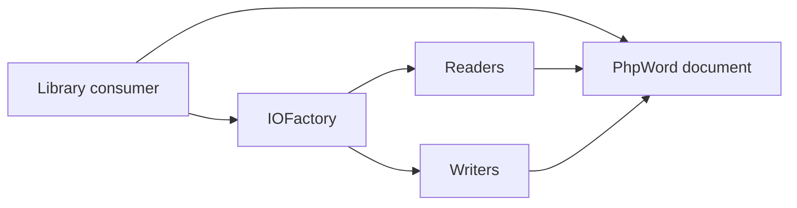

# PHPOffice/PHPWord

> PHP library to read and write Word, ODF, RTF, HTML and PDF documents.

## The problem
Generate Office files from PHP code without handling the XML by hand.

## What it actually does
You build a document from sections and elements (text, tables, images, charts, notes), then a writer serializes it to DOCX, ODT, RTF, HTML or PDF. A `TemplateProcessor` replaces variables in an OOXML template. PDF goes through Dompdf, mPDF or TCPDF.

## How it is wired


## Trying it
```bash
composer require phpoffice/phpword
php -S localhost:8000
```

## Cost and gotchas
Free. PHP 7.1 minimum, optional Zip, GD, XSL extensions. The license is present but not identified by GitHub; the README says it is LGPL v3. 1,246 open issues.

## What it is not
Not a layout engine: PDF goes through a third-party library and reading is uneven depending on the format.

## Alternatives
No alternative named in the README.

## For you
Ignore: PHP document-generation tool, outside your data / AI stack.
