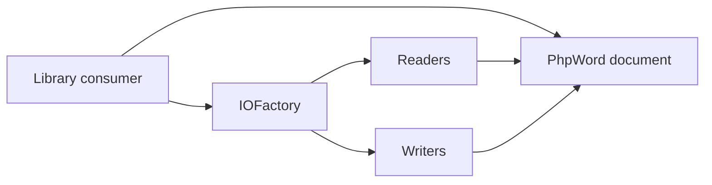

# PHPOffice/PHPWord

> Bibliothèque PHP pour lire et écrire des documents Word, ODF, RTF, HTML et PDF.

## Le problème
Générer des fichiers Office depuis du code PHP sans manipuler le XML à la main.

## Ce que ça fait vraiment
On construit un document en sections et éléments (texte, tableaux, images, graphiques, notes), puis un écrivain le sérialise en DOCX, ODT, RTF, HTML ou PDF. Un `TemplateProcessor` remplace des variables dans un modèle OOXML. Le PDF passe par Dompdf, mPDF ou TCPDF.

## Comment c'est branché


## Essayer
```bash
composer require phpoffice/phpword
php -S localhost:8000
```

## Coût et pièges
Gratuit. PHP 7.1 minimum, extensions Zip, GD, XSL optionnelles. La licence est présente mais non identifiée par GitHub ; le README la dit LGPL v3. 1 246 issues ouvertes.

## Ce que ce n'est pas
Ce n'est pas un moteur de mise en page : le PDF passe par une bibliothèque tierce et la lecture est inégale selon les formats.

## Alternatives
Aucune alternative nommée dans le README.

## Pour toi
À ignorer : outil PHP de génération de documents, hors de ta pile data / IA.

