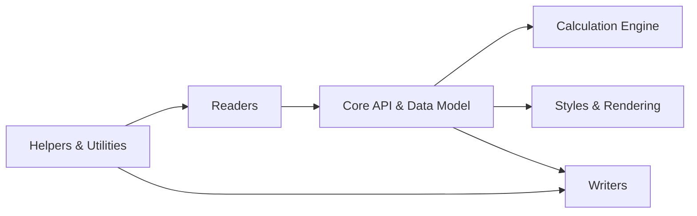

# PHPOffice/PhpSpreadsheet

> Pure PHP library to read and write Excel, LibreOffice, CSV and HTML workbooks.

## The problem
Generating or reading spreadsheet files from a PHP application, without Excel installed or a native extension.

## What it actually does
According to the architecture: readers (XLS, XLSX, CSV, ODS, HTML) fill a data model (Spreadsheet, Worksheet, Cell). A calculation engine evaluates formulas. Writers re-export to XLS, XLSX, ODS, CSV, PDF and HTML, with styles and charts. Successor to PHPExcel, which is no longer maintained.

## How it is wired

## Trying it
The README refers to the official documentation for installation and gives no command. No documented command.

## Cost and gotchas
Free. A Patreon offers early-access articles. The README does not document installation: you have to go to the documentation site.

## What it is not
Not compatible with PHPExcel: migration goes through an automatic tool. The master branch only receives security and bug fixes.

## Alternatives
- PHPExcel: ancestor, abandoned, not to be chosen.

## For you
Keep an eye on it: useful only if you produce Excel exports in a PHP backend, rare in data/AI; otherwise pandas/openpyxl are enough.
