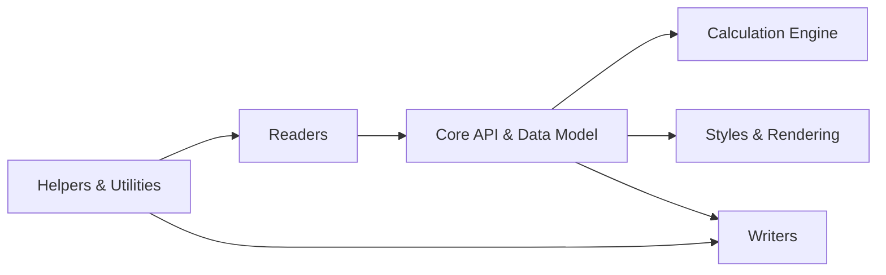

# PHPOffice/PhpSpreadsheet

> Bibliothèque PHP pure pour lire et écrire des classeurs Excel, LibreOffice, CSV et HTML.

## Le problème
Générer ou lire des fichiers tableur depuis une application PHP, sans Excel installé ni extension native.

## Ce que ça fait vraiment
D'après l'architecture : des lecteurs (XLS, XLSX, CSV, ODS, HTML) remplissent un modèle de données (Spreadsheet, Worksheet, Cell). Un moteur de calcul évalue les formules. Des écrivains réexportent vers XLS, XLSX, ODS, CSV, PDF et HTML, avec styles et graphiques. Successeur de PHPExcel, qui n'est plus maintenu.

## Comment c'est branché

## Essayer
Le README renvoie à la documentation officielle pour l'installation et ne donne aucune commande. Aucune commande documentée.

## Coût et pièges
Gratuit. Un Patreon propose des articles en avant-première. Le README ne documente pas l'installation : il faut aller sur le site de documentation.

## Ce que ce n'est pas
Pas compatible avec PHPExcel : la migration passe par un outil automatique. La branche master ne reçoit que des correctifs de sécurité et de bugs.

## Alternatives
- PHPExcel : ancêtre, abandonné, à ne pas choisir.

## Pour toi
À surveiller : utile seulement si tu produis des exports Excel dans un backend PHP, rare en data/IA ; sinon pandas/openpyxl suffisent.

