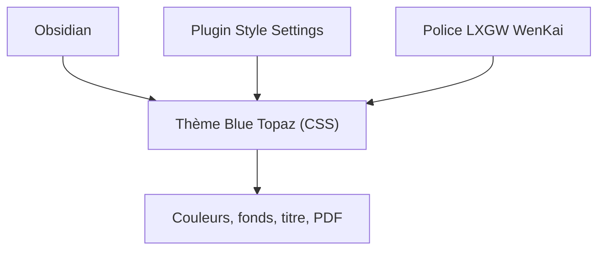

# PKM-er/Blue-Topaz_Obsidian-css

> CSS theme for Obsidian, designed for Chinese-language notes, with background images and customizable palettes.

## The problem
Obsidian's default rendering is a poor fit for anyone who wants a polished style and readable Chinese notes.

## What it actually does
A stylesheet theme configured with the Style Settings plugin: color scheme, background image for the workspace, notes, command palette or file explorer, colored title bar, layout, PDF. It recommends the LXGW WenKai font. A sample vault shows its uses.

## How it is wired
Simplified diagram based on the sheet, no diagram provided.



## Trying it
```bash
# Aucune commande documentée : installer le thème depuis Obsidian
# et le plugin Style Settings pour le régler.
```

## Cost and gotchas
Free, MIT. Online or vault-based background images are no longer provided because of Obsidian's policy: configure them by URL. The documentation is mostly in Chinese.

## What it is not
Not a functional plugin: it only changes the appearance. It does not replace your note organization.

## Alternatives
- Blue-topaz-examples (cumany): enriched sample vault cited by the README.

## For you
Ignore: graphical skin for Obsidian, with no effect on your data, AI or MLOps work.
