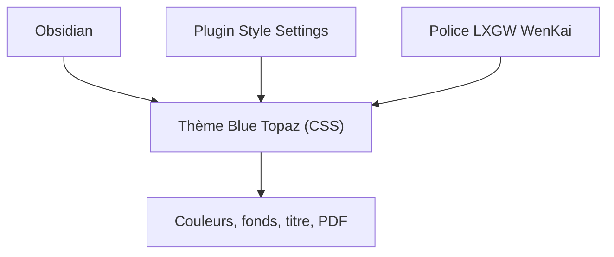

# PKM-er/Blue-Topaz_Obsidian-css

> Thème CSS pour Obsidian, pensé pour les notes en chinois, avec fonds d'image et palettes personnalisables.

## Le problème
Le rendu par défaut d'Obsidian convient mal à qui veut un style soigné et des notes en chinois lisibles.

## Ce que ça fait vraiment
Un thème de feuilles de style à régler avec le plugin Style Settings : schéma de couleurs, image de fond pour l'espace de travail, les notes, la palette de commandes ou l'explorateur de fichiers, barre de titre colorée, mise en page, PDF. Il recommande la police LXGW WenKai. Un coffre d'exemples montre ses usages.

## Comment c'est branché
Schéma simplifié d'après la fiche, sans diagramme fourni.



## Essayer
```bash
# Aucune commande documentée : installer le thème depuis Obsidian
# et le plugin Style Settings pour le régler.
```

## Coût et pièges
Gratuit, MIT. Les images de fond en ligne ou venant du coffre ne sont plus fournies à cause de la politique d'Obsidian : à configurer par URL. La documentation est surtout en chinois.

## Ce que ce n'est pas
Pas un plugin fonctionnel : il ne change que l'apparence. Il ne remplace pas ton organisation de notes.

## Alternatives
- Blue-topaz-examples (cumany) : coffre d'exemples enrichi cité par le README.

## Pour toi
À ignorer : habillage graphique d'Obsidian, sans effet sur ton travail data, IA ou MLOps.

