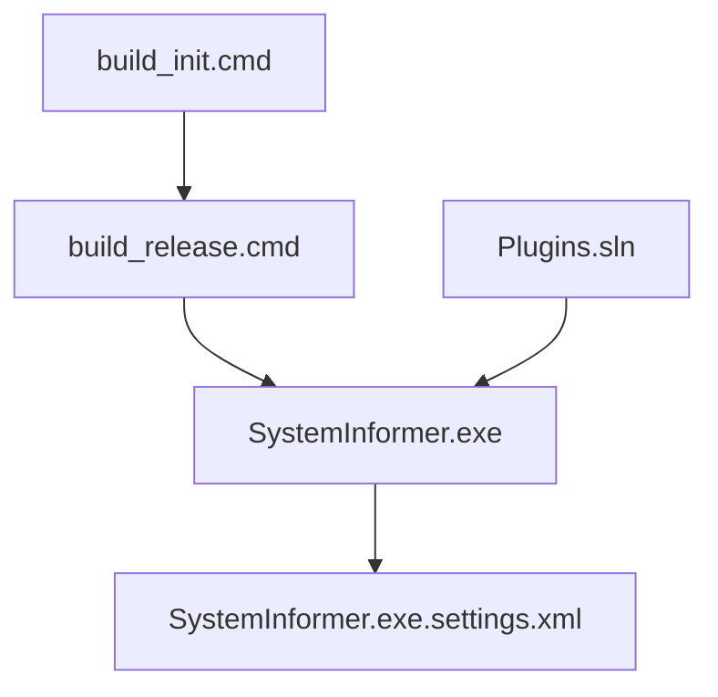

# PKRoma/ProcessHacker

> System Informer, a Windows tool for monitoring processes, services, network and disk, and for debugging.

## The problem
Knowing which process is locking a file, consuming resources or opening a connection is hard with the standard task manager.

## What it actually does
Detailed view of system activity with highlighting, graphs, processes using a file, active network connections, real-time disk access, call stacks (kernel, WOW64, .NET), service creation and control. Portable, no installation, Windows 10 or later. Published by Winsider Seminars & Solutions.

## How it is wired

Simplified diagram based on the sheet, no diagram provided.

## Trying it
```bash
build_init.cmd
build_release.cmd
```

## Cost and gotchas
Free. Build with Visual Studio 2022 or later. Portable settings are enabled by creating an empty SystemInformer.exe.settings.xml file.

## What it is not
Not an antivirus: the README says it helps detect malware, not block it. Windows only.

## Alternatives
No alternative named in the README.

## For you
Ignore: Windows utility for administrators, unrelated to data, AI or MLOps work (good to know for troubleshooting).
