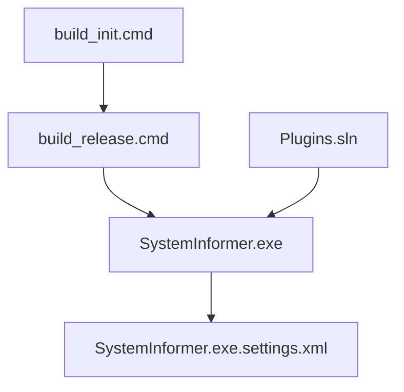

# PKRoma/ProcessHacker

> System Informer, outil Windows pour surveiller processus, services, réseau et disque, et déboguer.

## Le problème
Savoir quel processus bloque un fichier, consomme les ressources ou ouvre une connexion est difficile avec le gestionnaire de tâches standard.

## Ce que ça fait vraiment
Vue détaillée de l'activité système avec mise en évidence, graphiques, processus utilisant un fichier, connexions réseau actives, accès disque en temps réel, piles d'appels (noyau, WOW64, .NET), création et contrôle de services. Portable, sans installation, Windows 10 ou plus récent. Édité par Winsider Seminars & Solutions.

## Comment c'est branché

Schéma simplifié d'après la fiche, sans diagramme fourni.

## Essayer
```bash
build_init.cmd
build_release.cmd
```

## Coût et pièges
Gratuit. Compilation avec Visual Studio 2022 ou plus récent. Les réglages portables s'activent en créant un fichier SystemInformer.exe.settings.xml vide.

## Ce que ce n'est pas
Pas un antivirus : le README dit aider à détecter des logiciels malveillants, pas les bloquer. Windows uniquement.

## Alternatives
Aucune alternative nommée dans le README.

## Pour toi
À ignorer : utilitaire Windows pour administrateur, sans lien avec un travail data, IA ou MLOps (utile à connaître en dépannage).

