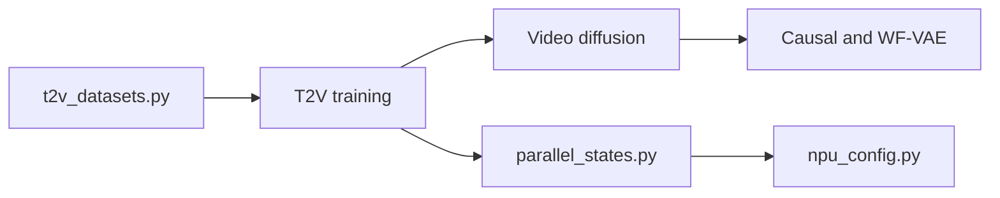

# PKU-YuanGroup/Open-Sora-Plan

> Open research project to reproduce a Sora-type video generation model.

## The problem
State-of-the-art text-to-video models are closed, which makes study and reproduction difficult.

## What it actually does
Publishes successive versions (v1.0 to v1.5) of a video VAE (WF-VAE) and a sparse-attention DiT (SUV, announced as over 35% faster). The repo contains training, inpainting, a prompt refiner, frame interpolation and a generation interface. v1.5 is trained on Huawei Ascend.

## How it is wired


## Trying it
```bash
# Aucune commande documentée : GPU « coming soon ».
# NPU : basculer sur la branche mindspeed_mmdit et suivre son README.
```

## Cost and gotchas
The v1.5 weights only work with NPU + MindSpeed-MM; GPU mode is not yet available. Some weights have watermarks.

## What it is not
Not usable on consumer GPUs as is for v1.5. 2+1D models are no longer supported since v1.2.

## Alternatives
Not documented: the README names no alternative.

## For you
Watch: useful for reading open research on generative video, but unusable on GPU until the GPU mode is released.
