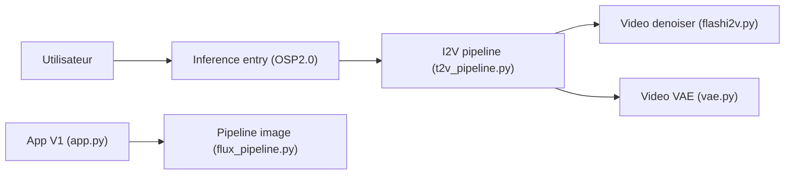

# PKU-YuanGroup/UniWorld-V1

> Family of image and video generation and editing models from a university lab.

## The problem
Unifying visual understanding, generation and image editing in a single open model.

## What it actually does
- README almost entirely commented out: only a title, a "Citing" section and BibTeX references remain visible.
- Judging from the code architecture: OSP2.0 (image to video, FlashI2V), V1 (understanding + generation + editing, Flux pipeline, OCR) and V2 (reward-based fine-tuning for editing).
- Also contains distributed training (FSDP2), checkpoints and benchmarks (`eval_flashi2v.py`).
- The commented-out README mentions V1 results on 20+ tasks, with no usable detail.

## How it is wired


## Trying it
```bash
# Aucune commande documentée dans le README fourni.
```

## Cost and gotchas
GPU expected but not quantified. No license declared: usage rights uncertain. Installation documentation absent from the visible README. 15 open issues.

## What it is not
Not a product usable as-is from the README: you have to read the code. The titles of the cited papers (UniWorld, UniWorld-V2, ImgEdit) are not guarantees of results.

## Alternatives
No alternative named in the README.

## For you
Ignore: no license and no readable instructions; come back if the README is completed.
