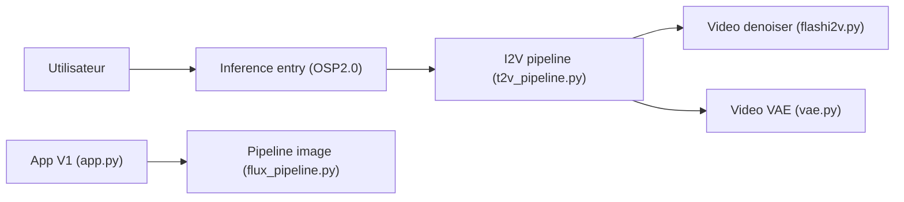

# PKU-YuanGroup/UniWorld-V1

> Famille de modèles de génération et d'édition d'images et de vidéos issue d'un laboratoire universitaire.

## Le problème
Unifier compréhension visuelle, génération et édition d'images avec un même modèle ouvert.

## Ce que ça fait vraiment
- README presque entièrement commenté : seuls un titre, une section « Citing » et des références BibTeX restent visibles.
- D'après l'architecture du code : OSP2.0 (image vers vidéo, FlashI2V), V1 (compréhension + génération + édition, pipeline Flux, OCR) et V2 (réglage fin par récompense pour l'édition).
- Contient aussi entraînement distribué (FSDP2), checkpoints et benchmarks (`eval_flashi2v.py`).
- Le README commenté évoque des résultats V1 sur 20+ tâches, sans détail exploitable.

## Comment c'est branché


## Essayer
```bash
# Aucune commande documentée dans le README fourni.
```

## Coût et pièges
GPU attendu mais non chiffré. Aucune licence déclarée : droit d'usage incertain. Documentation d'installation absente du README visible. 15 issues ouvertes.

## Ce que ce n'est pas
Pas un produit utilisable en l'état à partir du README : il faut lire le code. Les titres des articles cités (UniWorld, UniWorld-V2, ImgEdit) ne sont pas des garanties de résultats.

## Alternatives
Aucune alternative nommée dans le README.

## Pour toi
À ignorer : pas de licence ni de mode d'emploi lisible ; reviens-y si le README est complété.

