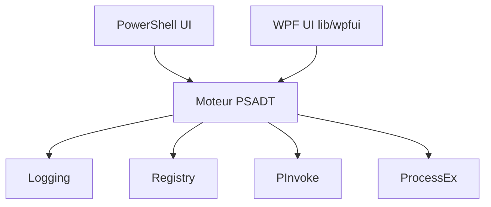

# PSAppDeployToolkit/PSAppDeployToolkit

> PowerShell framework for deploying Windows software with a UI, logging and Intune or ConfigMgr integration.

## The problem
Deploying Windows installers in a company without a framework leads to failures, few traces and no clean user interaction.

## What it actually does
A prescriptive deployment flow, functions for common tasks (registry, processes, welcome and restart prompts) and a Fluent or classic interface. Logs in detail. Integrates with Intune, ConfigMgr, Tanium, BigFix. Version 4.2 RC2 adds, among other things, restart options and group policies.

## How it is wired

## Trying it
No command in the README: download via PowerShell Gallery or GitHub Releases. Prerequisites: Windows 10/11, PowerShell 5.1, .NET Framework 4.7.2.

## Cost and gotchas
Free. Windows only. LGPL-3.0. Version 4.2 is a preview (RC2) according to the README.

## What it is not
Not cross-platform nor a data tool. Not a deployment system in itself: it complements Intune or ConfigMgr.

## Alternatives
No alternative named in the README.

## For you
Ignore: Windows administration tooling, unrelated to data / AI / MLOps work.
