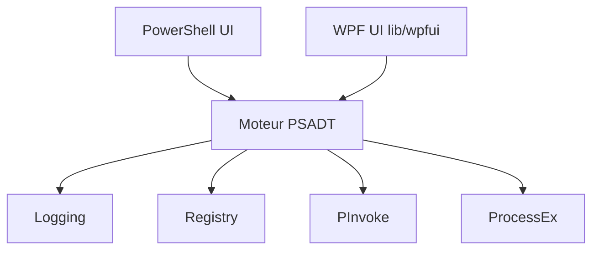

# PSAppDeployToolkit/PSAppDeployToolkit

> Framework PowerShell pour déployer des logiciels Windows avec interface, journalisation et intégration Intune ou ConfigMgr.

## Le problème
Déployer des installateurs Windows en entreprise sans cadre donne des échecs, peu de traces et aucune interaction utilisateur propre.

## Ce que ça fait vraiment
Un flux de déploiement prescriptif, des fonctions pour les tâches courantes (registre, processus, invites de bienvenue et de redémarrage) et une interface Fluent ou classique. Journalise en détail. S'intègre à Intune, ConfigMgr, Tanium, BigFix. La version 4.2 RC2 ajoute notamment des options de redémarrage et des stratégies de groupe.

## Comment c'est branché

## Essayer
Aucune commande dans le README : téléchargement via PowerShell Gallery ou GitHub Releases. Prérequis : Windows 10/11, PowerShell 5.1, .NET Framework 4.7.2.

## Coût et pièges
Gratuit. Windows uniquement. LGPL-3.0. La version 4.2 est en préversion (RC2) d'après le README.

## Ce que ce n'est pas
Pas multiplateforme ni un outil data. Pas un système de déploiement en soi : il complète Intune ou ConfigMgr.

## Alternatives
Aucune alternative nommée dans le README.

## Pour toi
À ignorer : outillage d'administration Windows, sans lien avec un travail data / IA / MLOps.

