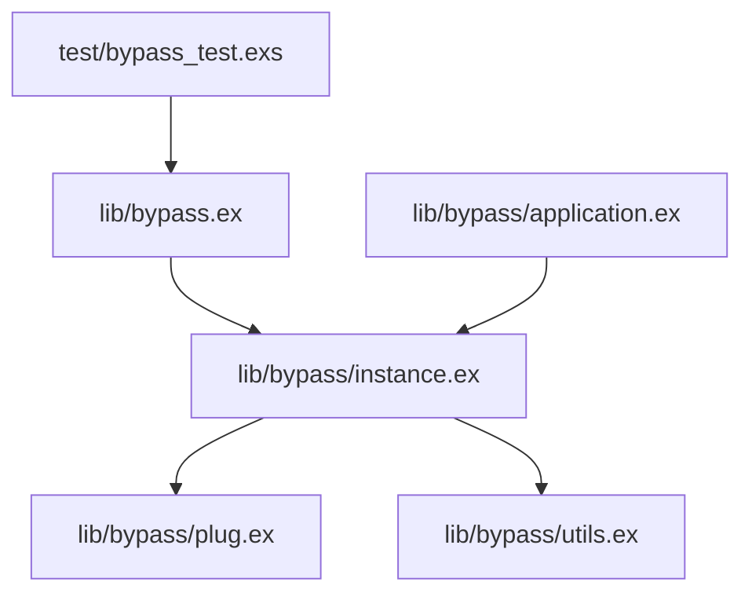

# PSPDFKit-labs/bypass

> Fake HTTP server for Elixir tests, which returns prepared responses to your client.

## The problem
Test an HTTP client's error handling without a real server or network calls.

## What it actually does
`Bypass.open()` starts an instance on a unique port; `expect`, `expect_once` and `stub` install responses per route or generic ones. `down` and `up` simulate a server outage. Compatible with ExUnit and ESpec, with concurrent instances. Expectations are verified at the end of the test.

## How it is wired


## Trying it
```bash
# mix.exs : {:bypass, "~> 2.1", only: :test}
# puis dans un test : bypass = Bypass.open()
```

## Cost and gotchas
Free. Last push July 2025. `Bypass.open/0` must not be called in `setup_all`. Designed for Elixir 1.10 and OTP 21 and above with Cowboy 2.

## What it is not
Not a load testing tool nor a full API simulator.

## Alternatives
No alternative named in the README.

## For you
Ignore: reserved for Elixir tests, and no activity for over a year.
