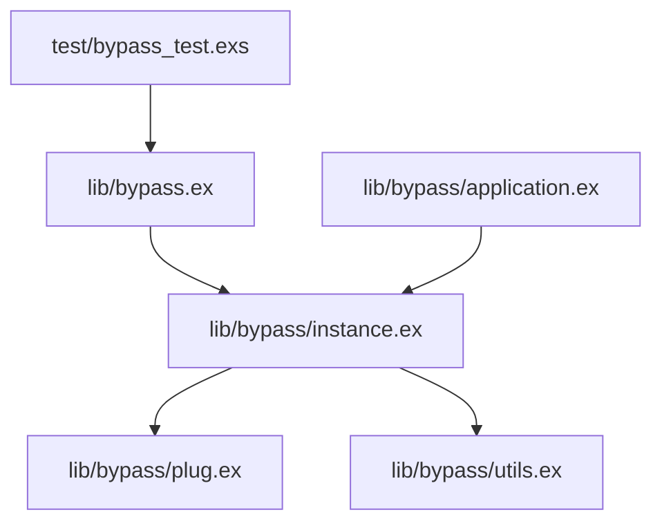

# PSPDFKit-labs/bypass

> Faux serveur HTTP pour tests Elixir, qui renvoie des réponses préparées à votre client.

## Le problème
Tester la gestion des erreurs d'un client HTTP sans serveur réel ni appels réseau.

## Ce que ça fait vraiment
`Bypass.open()` démarre une instance sur un port unique ; `expect`, `expect_once` et `stub` installent des réponses par route ou génériques. `down` et `up` simulent une panne du serveur. Compatible ExUnit et ESpec, avec instances concurrentes. Les attentes sont vérifiées en fin de test.

## Comment c'est branché


## Essayer
```bash
# mix.exs : {:bypass, "~> 2.1", only: :test}
# puis dans un test : bypass = Bypass.open()
```

## Coût et pièges
Gratuit. Dernier push en juillet 2025. `Bypass.open/0` ne doit pas être appelé dans `setup_all`. Prévu pour Elixir 1.10 et OTP 21 et plus avec Cowboy 2.

## Ce que ce n'est pas
Pas un outil de test de charge ni un simulateur d'API complet.

## Alternatives
Aucune alternative nommée dans le README.

## Pour toi
Ignorer : réservé aux tests Elixir, et sans activité depuis plus d'un an.

