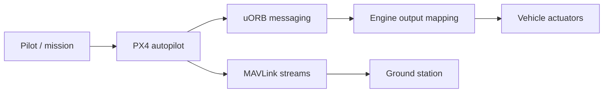

# PX4/PX4-Autopilot

> Open-source autopilot software stack for drones and unmanned vehicles.

## The problem
Piloting drones, planes and rovers requires a modular flight stack, compatible with many boards and sensors.

## What it actually does
Modules working by publish/subscribe via uORB, from pilot or mission inputs to actuator outputs, with flight mode management (fixed wing), motor control and output mixing. Runs on NuttX, Linux and macOS. MAVLink, ROS 2/DDS, SITL simulation and EKF log analysis are built in.

## How it is wired


## Trying it
```bash
docker run --rm -it -p 14550:14550/udp px4io/px4-sitl:latest
git clone https://github.com/PX4/PX4-Autopilot.git --recursive
cd PX4-Autopilot
make px4_sitl
```

## Cost and gotchas
Free. For a real flight, you need a compatible Pixhawk board and hardware. The simulator requires QGroundControl.

## What it is not
Not a turnkey drone app nor a computer vision tool. It is the flight layer.

## Alternatives
No alternative named in the README.

## For you
Ignore: embedded robotics, outside the data/AI/MLOps scope, except for a drone project.
