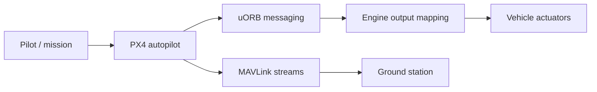

# PX4/PX4-Autopilot

> Pile logicielle de pilotage automatique open source pour drones et véhicules sans pilote.

## Le problème
Piloter drones, avions et rovers demande une pile de vol modulaire, compatible avec beaucoup de cartes et de capteurs.

## Ce que ça fait vraiment
Modules fonctionnant par publication/abonnement via uORB, des entrées pilote ou mission aux sorties vers les actionneurs, avec gestion des modes de vol (voilure fixe), contrôle moteur et mixage de sorties. Tourne sous NuttX, Linux et macOS. MAVLink, ROS 2/DDS, simulation SITL et analyse de logs EKF sont intégrés.

## Comment c'est branché


## Essayer
```bash
docker run --rm -it -p 14550:14550/udp px4io/px4-sitl:latest
git clone https://github.com/PX4/PX4-Autopilot.git --recursive
cd PX4-Autopilot
make px4_sitl
```

## Coût et pièges
Gratuit. Pour un vol réel, il faut une carte Pixhawk compatible et du matériel. Le simulateur demande QGroundControl.

## Ce que ce n'est pas
Pas une appli de drone clé en main ni un outil de vision par ordinateur. C'est la couche de vol.

## Alternatives
Aucune alternative nommée dans le README.

## Pour toi
Ignorer : robotique embarquée, hors périmètre data/IA/MLOps, sauf projet de drones.

