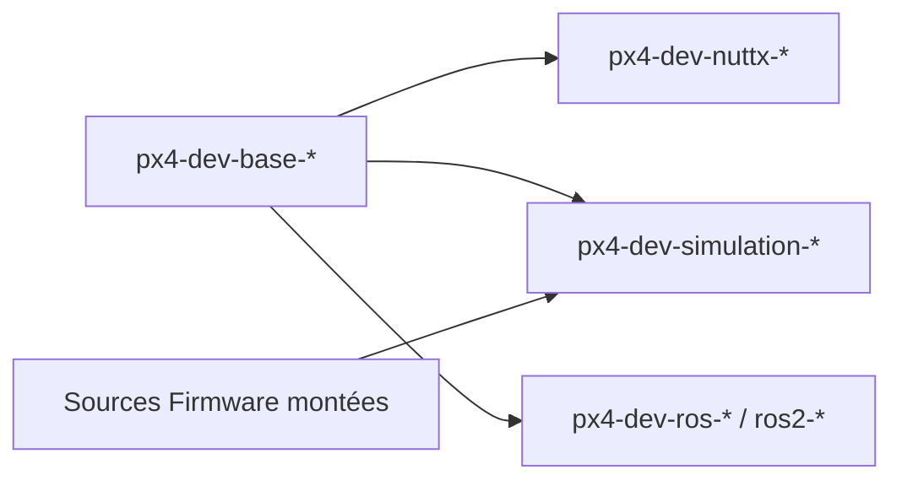

# PX4/PX4-containers

> Dockerfiles to build and test the PX4 flight software, with or without ROS and ROS2.

## The problem
Building PX4 requires toolchains (NuttX, simulation, ROS) that are tricky to reproduce from one machine to another.

## What it actually does
Provides a hierarchy of `px4io/px4-dev-*` images: bases (Arch, Bionic, Focal, Jammy, Noble), Clang, NuttX, Raspberry Pi, simulation, ROS (Melodic, Noetic), ROS2 (Dashing to Rolling), armhf, aarch64 and documentation. You run an image with the PX4 sources mounted as a volume, or build it via `docker build` or `make`.

## How it is wired
Simplified diagram based on the sheet, no diagram provided.


## Trying it
```bash
docker run -it --rm \
    -v <local_src>:/home/user/Firmware:rw \
    -v /tmp/.X11-unix:/tmp/.X11-unix:ro \
    -e DISPLAY=${DISPLAY} \
    -e LOCAL_USER_ID="$(id -u)" \
    --name=container_name px4io/px4-dev-simulation-bionic /bin/bash
cd docker && make px4-dev-ros-melodic
```

## Cost and gotchas
Docker and the PX4 sources. Last push in March 2025; many images target old distributions (Bionic, Melodic). License deferred to that of the PX4 Firmware repository, not declared here.

## What it is not
Not the PX4 software: only its build environments. Not a data tool.

## Alternatives
None named in the README.

## For you
Ignore: build environments for drones, outside the data / AI / MLOps scope.
