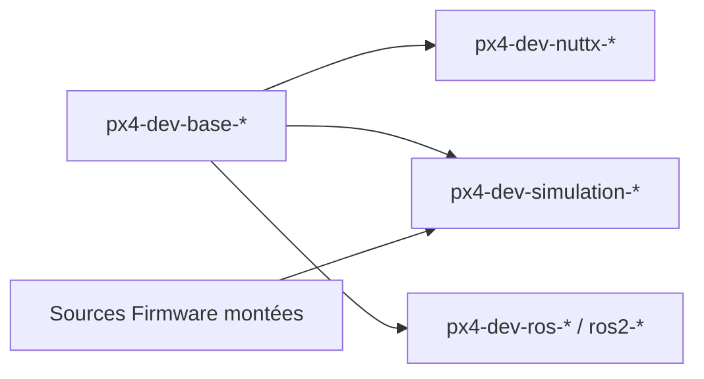

# PX4/PX4-containers

> Dockerfiles pour compiler et tester le logiciel de vol PX4, avec ou sans ROS et ROS2.

## Le problème
Compiler PX4 demande des chaînes d'outils (NuttX, simulation, ROS) délicates à reproduire d'une machine à l'autre.

## Ce que ça fait vraiment
Fournit une hiérarchie d'images `px4io/px4-dev-*` : bases (Arch, Bionic, Focal, Jammy, Noble), Clang, NuttX, Raspberry Pi, simulation, ROS (Melodic, Noetic), ROS2 (Dashing à Rolling), armhf, aarch64 et documentation. On lance une image avec les sources de PX4 montées en volume, ou on la construit via `docker build` ou `make`.

## Comment c'est branché
Schéma simplifié d'après la fiche, sans diagramme fourni.


## Essayer
```bash
docker run -it --rm \
    -v <local_src>:/home/user/Firmware:rw \
    -v /tmp/.X11-unix:/tmp/.X11-unix:ro \
    -e DISPLAY=${DISPLAY} \
    -e LOCAL_USER_ID="$(id -u)" \
    --name=container_name px4io/px4-dev-simulation-bionic /bin/bash
cd docker && make px4-dev-ros-melodic
```

## Coût et pièges
Docker et les sources de PX4. Dernier push en mars 2025 ; beaucoup d'images visent des distributions anciennes (Bionic, Melodic). Licence renvoyée à celle du dépôt PX4 Firmware, non déclarée ici.

## Ce que ce n'est pas
Pas le logiciel PX4 : seulement ses environnements de build. Pas un outil de données.

## Alternatives
Aucune nommée dans le README.

## Pour toi
Ignorer : environnements de build pour drones, hors du périmètre data / IA / MLOps.

