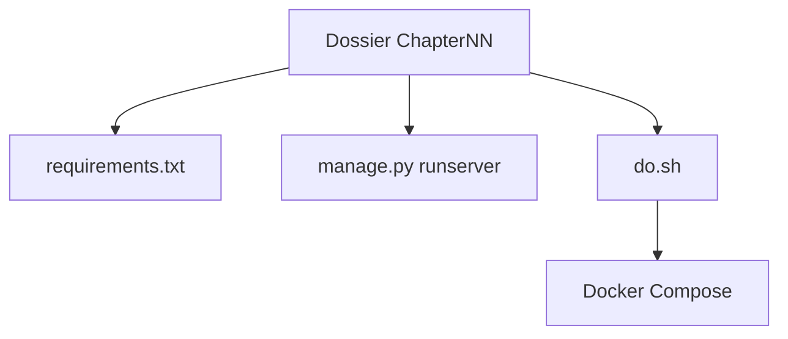

# PacktPublishing/Django-5-By-Example

> Companion code for the book Django 5 by Example: four web applications to rebuild chapter by chapter.

## The problem
Learning Django without guided complete projects leads to isolated examples, with no overview of a real site.

## What it actually does
- One folder per chapter, each with its own `requirements.txt`.
- Four projects: blog, social site, online shop, e-learning platform.
- Covers Celery, Redis, Stripe, Django REST Framework, Channels and a Docker Compose deployment.
- A `do.sh` script to build and run each chapter.

## How it is wired

Simplified diagram based on the sheet, no diagram provided.

## Trying it
```bash
pip install -r requirements.txt
python manage.py runserver
./do.sh build
./do.sh run
```

## Cost and gotchas
Python 3.12 or later and Django 5. The book itself is paid; Docker Compose is explained in chapter 17. Some chapters require Redis, RabbitMQ or Stripe.

## What it is not
Not a framework nor a reusable template: educational code tied to the book, without the explanatory text.

## Alternatives
No alternative named in the README, apart from earlier editions of the same book.

## For you
Worth watching: useful only if you follow the book or want to build a Django backend to serve a model; without the text, the code alone teaches little.
