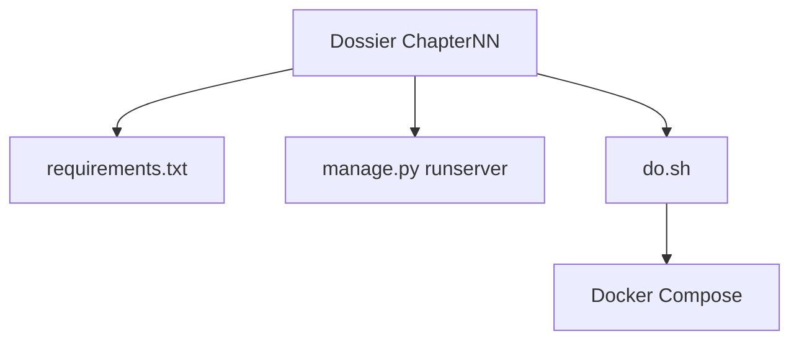

# PacktPublishing/Django-5-By-Example

> Code d'accompagnement du livre Django 5 by Example : quatre applications web à refaire chapitre par chapitre.

## Le problème
Apprendre Django sans projets complets guidés mène à des exemples isolés, sans vue d'ensemble d'un vrai site.

## Ce que ça fait vraiment
- Un dossier par chapitre, chacun avec son `requirements.txt`.
- Quatre projets : blog, site social, boutique en ligne, plateforme d'e-learning.
- Couvre Celery, Redis, Stripe, Django REST Framework, Channels et un déploiement Docker Compose.
- Un script `do.sh` pour construire et lancer chaque chapitre.

## Comment c'est branché

Schéma simplifié d'après la fiche, sans diagramme fourni.

## Essayer
```bash
pip install -r requirements.txt
python manage.py runserver
./do.sh build
./do.sh run
```

## Coût et pièges
Python 3.12 ou plus et Django 5. Le livre lui-même est payant ; Docker Compose est expliqué au chapitre 17. Certains chapitres demandent Redis, RabbitMQ ou Stripe.

## Ce que ce n'est pas
Pas un framework ni un modèle réutilisable : du code pédagogique lié au livre, sans le texte explicatif.

## Alternatives
Aucune alternative nommée dans le README, hormis les éditions précédentes du même livre.

## Pour toi
À surveiller : utile seulement si tu suis le livre ou veux monter un back Django pour servir un modèle ; sans le texte, le code seul apprend peu.

