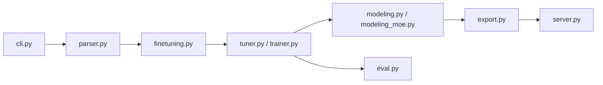

# PaddlePaddle/ERNIE

> The ERNIE 4.5 family of open models (text and vision) with training and deployment tools on PaddlePaddle.

## The problem
Having large open multimodal MoE models, with the means to fine-tune and serve them, without depending on a closed API.

## What it actually does
Publishes ten ERNIE 4.5 variants (LLMs from 0.3B to 300B-A47B, VLMs up to 424B-A47B) under Apache 2.0. ERNIEKit covers SFT, DPO, LoRA and QAT; FastDeploy serves the models with an OpenAI-compatible API. VLM training is announced as "Coming Soon" in the README matrix. The analyzed code shows a CLI, an argument parser, a WebUI, a tuner, an SFT trainer, evaluation, export and a server.

## How it is wired


## Trying it
```bash
huggingface-cli download baidu/ERNIE-4.5-0.3B-Paddle --local-dir baidu/ERNIE-4.5-0.3B-Paddle
erniekit train examples/configs/ERNIE-4.5-0.3B/sft/run_sft_8k.yaml
python -m fastdeploy.entrypoints.openai.api_server \
    --model "baidu/ERNIE-4.5-0.3B-Paddle" \
    --max-model-len 32768 \
    --port 9904
```

## Cost and gotchas
The large models require many GPUs; training hardware requirements are deferred to an external page. The README gives neither the ERNIEKit nor the FastDeploy installation command.

## What it is not
Not a PyTorch ecosystem: everything goes through PaddlePaddle. The benchmarks are the publisher's own. The 0.3B is for testing, not for judging the large models.

## Alternatives
- DeepSeek-V3 and Qwen3: cited in the README as comparison references.

## For you
Worth watching: the open Apache 2.0 weights deserve a try, but the Paddle tooling takes you away from a usual PyTorch stack and the installation is not described here.
