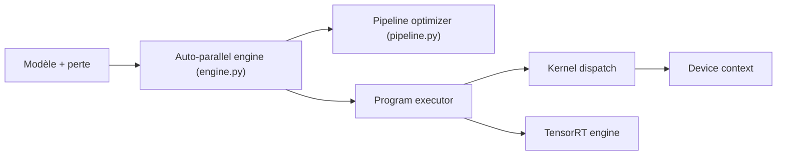

# PaddlePaddle/Paddle

> Chinese deep learning platform for training and inference of large models.

## The problem
Training and deploying large models on clusters and a variety of chips without rewriting parallelism by hand.

## What it actually does
Framework with unified dynamic and static graphs, automatic parallelism (minimal partition annotations), training and inference in the same framework, higher-order differentiation for scientific computing, a neural network compiler, multi-chip adaptation. The README cites 23.33 million developers (vendor figures).

## How it is wired

## Trying it
No command documented in the README; it points to the "Quick Install" on the website.

## Cost and gotchas
Free; GPU needed for real training. The README mentions a "Fluid" example, an old name. 1,458 open issues.

## What it is not
Not a simple PyTorch wrapper. The ecosystem is smaller outside China.

## Alternatives
No alternative named in the README.

## For you
Worth watching if you target Chinese hardware (non-NVIDIA chips) or scientific computing research; otherwise, PyTorch remains the default choice.
