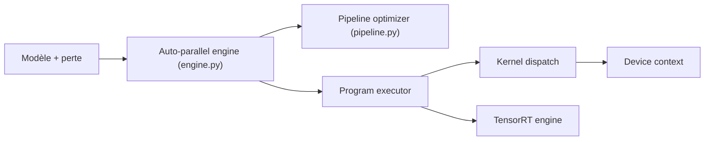

# PaddlePaddle/Paddle

> Plateforme chinoise de deep learning pour l'entraînement et l'inférence de grands modèles.

## Le problème
Entraîner et déployer de gros modèles sur des clusters et des puces variées sans réécrire le parallélisme à la main.

## Ce que ça fait vraiment
Framework avec graphes dynamiques et statiques unifiés, parallélisme automatique (annotations de partition minimales), entraînement et inférence dans le même framework, différentiation d'ordre supérieur pour le calcul scientifique, compilateur de réseaux de neurones, adaptation multi-puces. Le README cite 23,33 millions de développeurs (chiffres de l'éditeur).

## Comment c'est branché

## Essayer
Aucune commande documentée dans le README ; il renvoie au « Quick Install » du site.

## Coût et pièges
Gratuit ; GPU pour de vrais entraînements. Le README mentionne un exemple « Fluid », ancien nom. 1 458 issues ouvertes.

## Ce que ce n'est pas
Pas un simple wrapper de PyTorch. L'écosystème est plus restreint hors de Chine.

## Alternatives
Aucune alternative nommée dans le README.

## Pour toi
À surveiller si tu cibles du matériel chinois (puces non NVIDIA) ou la recherche en calcul scientifique ; sinon, PyTorch reste le choix par défaut.

