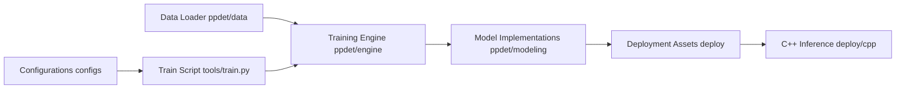

# PaddlePaddle/PaddleDetection

> Object detection toolkit on PaddlePaddle; English README empty, points to the Chinese one.

## The problem
Not documented in the provided README (it only contains "README_cn.md").

## What it actually does
According to the described architecture: data loading and transformation (`ppdet/data`), models configured in YAML (`configs`).
Backbones, necks, heads in `ppdet/modeling`, pre-trained model zoo, training engine `ppdet/engine`.
Export and deployment: `deploy/serving`, `deploy/fastdeploy`, C++ inference.

## How it is wired

## Trying it
No command documented in the provided README.

## Cost and gotchas
Free; training on GPU, dependency on the PaddlePaddle framework.

## What it is not
Not a PyTorch library. The real docs are in `README_cn.md`, not provided here.

## Alternatives
No alternative named in the README.

## For you
Worth watching only if you must deploy detection on the Paddle ecosystem; material too thin here to conclude further.
