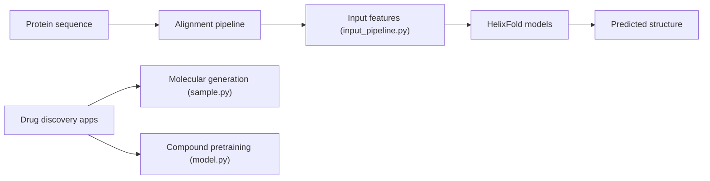

# PaddlePaddle/PaddleHelix

> Deep learning bioinformatics toolkit on PaddlePaddle: drugs, proteins, RNA.

## The problem
Researchers in drug discovery and vaccine design lack a coherent set of pre-trained models and applications.

## What it actually does
Research repository grouping compound and protein pre-training, property and drug-target affinity prediction (GraphDTA, MolTrans), molecular generation, drug synergy, protein folding (HelixFold, HelixFold-Single, HelixFold3), RNA algorithms (LinearFold, LinearPartition) and competition solutions. Each application has its own folder, with no common layer.

## How it is wired

## Trying it
No command documented in the README: it points to an installation guide and external tutorials.

## Cost and gotchas
Free, but installation, possible GPU and Python version are not specified in this README. Based on PaddlePaddle, not PyTorch. 76 open issues.

## What it is not
Not a ready-to-use service: it is a set of heterogeneous research applications. License present but not identified by GitHub.

## Alternatives
No alternative named in the README.

## For you
Worth watching: useful only if you work in bioinformatics and accept PaddlePaddle; check the license before any reuse.
