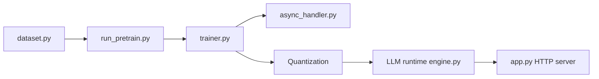

# PaddlePaddle/PaddleNLP

> Suite for training, compressing and running inference of large models on the PaddlePaddle framework.

## The problem
Training and serving an LLM on several types of hardware means stitching together parallelism, precision and quantization.

## What it actually does
4D pre-training (data, tensor, pipeline, parameter sharding), fine-tuning (SFT, LoRA, FlashMask, DPO and variants), quantization and optimized inference (INT8/INT4, FP8). Hardware: NVIDIA GPU, XPU, Ascend NPU, GCU, DCU. Models: Llama, Qwen, DeepSeek, ChatGLM, Baichuan, Mistral, etc. Unified checkpoint with asynchronous saving.

## How it is wired


## Trying it
```bash
pip install --upgrade paddlenlp==3.0.0b4
python -u run_pretrain.py ./config/qwen/pretrain_argument_0p5b.json
python -u run_finetune.py ./config/qwen/sft_argument_0p5b.json
```

## Cost and gotchas
Requires `paddlepaddle >= 3.0.0rc1` and Python 3.8+. Paddle ecosystem distinct from PyTorch. README in Chinese first.

## What it is not
It is not a PyTorch wrapper: it is a different framework. The pre-training example assumes downloading the sample data.

## Alternatives
Not documented: the README names no alternative.

## For you
Worth watching: interesting if you target Chinese hardware (Ascend, Kunlun); otherwise the PyTorch ecosystem remains more common.
