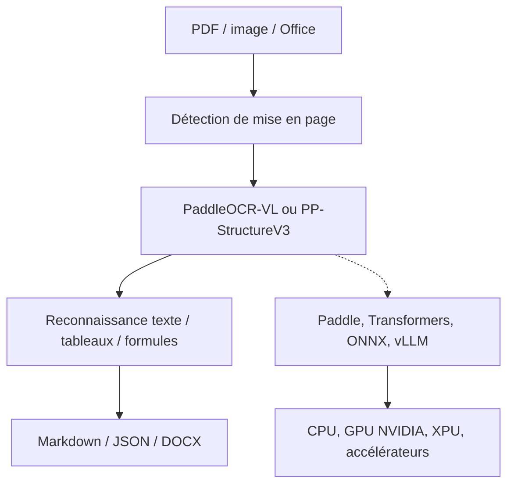

# PaddlePaddle/PaddleOCR

> OCR toolkit and document understanding engine, which converts Markdown and JSON into other formats.

## The problem
A scanned PDF or a document photo provides no usable information for an LLM.
General OCR software loses the layout, tables, and formulas.

## What it actually does
PaddleOCR-VL-1.6 (0.9 million of parameters) parses a page into Markdown or structured JSON.
PP-StructureV3 does the same thing with fine-grained coordinates: table cells, text blocks.
PP-OCRv6 recognizes 50 languages with a single model, in three sizes: 1.5 M, 7.7 M, and 34.5 M of parameters.
HPD-Parsing focuses on throughput, delivered via a custom vLLM runtime or an OpenAI-compatible API.
Export to ONNX, OpenVINO/TensorRT acceleration, multi-GPU parallel inference, `PaddleOCR.js` browser SDK.

## How it is wired

## Trying it
The installation instructions are not provided in the README; instead, it directs users to the PP-OCR, PaddleOCR-VL, and PP-StructureV3 pages.

## Cost and gotchas
Free and executable locally. Without a GPU, VL parsing remains slow despite the advertised CPU gains.
Models are downloaded from HuggingFace, ModelScope, or AIStudio – be sure to account for bandwidth requirements.

## What it is not
Not just a simple `pip install`: the version of the Paddle framework and the underlying hardware all play a crucial role.
The accuracy figures (96.3% on OmniDocBench v1.6) are self-reported by the publisher.
Not a RAG pipeline: it produces structured text, nothing else.

## Alternatives
- `microsoft/markitdown`: simpler, when documents are natively digital.
- `infiniflow/ragflow`: This already includes this type of parsing within a complete string.

## For you
The best OCR/document brick from this selection for feeding a RAG system from scans. Highly recommended.
